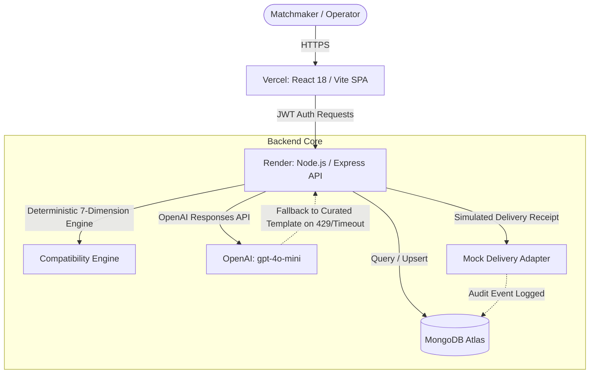

# The Date Crew — Matchmaker Dashboard MVP

> Boutique Matrimonial Operations Software & Explainable Compatibility Engine

---

## 1. Project Overview
**The Date Crew** is a specialized operations dashboard designed for matrimonial relationship managers and senior matchmakers. It allows matchmakers to:
- Authenticate into a secure operations portal.
- Manage customer biodata across personal, cultural, educational, lifestyle, and astrological criteria.
- Configure and evaluate explicit partner expectations and flexibility criteria.
- Run an explainable **7-dimension compatibility algorithm** against a synthetic opposite-gender candidate pool.
- Generate personalized candidate introductions (using OpenAI or curated matrimonial templates).
- Dispatch match proposals with side-by-side profile review and mock email delivery.
- Maintain customer journey states (`New` → `Active` → `Matched` → `Closed`) and log operational consultation notes.

---

## 2. Tech Stack
- **Frontend:** React 18, Vite 5, TypeScript (strict mode), Tailwind CSS, React Router 6, Axios.
- **Backend:** Node.js, Express, TypeScript, Mongoose ODM, MongoDB.
- **Security:** JWT authentication, bcrypt password hashing, input sanitization, and ObjectId validation.
- **AI Integration:** OpenAI API (GPT-4o-mini) for customized candidate introductions with template fallback.
- **Hosting Targets:** Vercel (Frontend), Render (Backend), MongoDB Atlas.

---

## 3. Live Deployment & Demo Credentials

### Live Production Services

| Service | Live URL | Provider | Status |
|---|---|---|---|
| **Frontend Application** | [https://matchmaker-algo.vercel.app](https://matchmaker-algo.vercel.app) | Vercel | Active |
| **Backend API** | [https://matchmaker-algo-n65x.onrender.com](https://matchmaker-algo-n65x.onrender.com) | Render | Active |
| **Backend Health Probe** | [https://matchmaker-algo-n65x.onrender.com/health](https://matchmaker-algo-n65x.onrender.com/health) | Render | Active |
| **Database** | MongoDB Atlas (M0 Cluster) | MongoDB Atlas | Connected |

### Demo Credentials

| Role | Email | Password |
|---|---|---|
| Matchmaker | `matchmaker@datecrew.in` | `Demo@1234` |
| Senior Matchmaker | `lead@datecrew.in` | `Demo@1234` |

> *Note: All profiles, names, incomes, and details are strictly synthetic and fictional.*

---

## 4. Setup & Local Development

### Prerequisites
- Node.js (v18.x or v20.x+)
- npm or yarn
- MongoDB instance (local or MongoDB Atlas free tier connection string)

### 4.1 Backend Setup (`/server`)
```bash
cd server
npm install

# Configure environment variables
cp .env.example .env
# Edit .env and supply your MONGODB_URI and JWT_SECRET
# Seed demo matchmaker accounts and 120 deterministic fictional candidate profiles:
npm run seed

# Run in development mode:
npm run dev

# Run automated test suite (including seed and schema verification):
npm test
```

### 4.2 Seed Data & Fictional Profile Details
The seed script (`server/src/seed/seedCandidatesDeterministic.ts`) creates **120 unique, idempotent, and fully synthetic Indian matrimonial candidate profiles**:
- **Adult Demographics:** Ages 21–45 (strictly adults).
- **Gender Balance:** Exactly 60 males and 60 females.
- **Client & Candidate Split:** 40 paying clients (20M + 20F with `isClient: true`), 80 pool candidates (`isClient: false`).
- **Comprehensive Biodata:**
  - `firstName`, `lastName`, `fullName`, `gender`, `dob`, `country`, `city`, `state`, `nativePlace`, `heightCm`
  - Fictional contact: `email` (e.g., `*.profileid@fictional-demo-datecrew.in`), `phone` (`+91-98000-xxxxx`)
  - Education & Profession: `undergraduateCollege`, `degree`, `education`, `educationField`, `annualIncomeINR`, `company`, `designation`, `occupation`
  - Community & Culture: `religion`, `caste`, `motherTongue`, `languages`, `isManglik`
  - Family: `familyType`, `familyValues`, `fatherOccupation`, `motherOccupation`, `numberOfSiblings`, `siblings`
  - Personal Expectations: `childrenPreference`, `relocationPreference`, `petPreference`, `careerGoals`, `relationshipExpectations`
  - Lifestyle: `diet`, `smoking`, `drinking`, `hobbies`, `lifestylePreferences`
  - Astrological & Completeness: `rashi`, `nakshatra`, `selfDescription`, `profileCompleteness: 95%`
- **Separated Partner Criteria:** Stored in the dedicated `MatchPreference` collection referencing each candidate.
- **Synthetic Safety:** Every record is stamped with `isSynthetic: true` and `verificationStatus: "unverified"`.
- **Idempotency:** Safe to run repeatedly; profiles are upserted by unique `profileId` without generating duplicates.


### 4.2 Frontend Setup (`/client`)
```bash
cd client
npm install

# Configure API URL if different from default localhost:4000
cp .env.example .env

# Run Vite development server:
npm run dev
```
Open `http://localhost:5173` in your browser.

---

## 5. API Documentation

### Authentication
- `POST /api/auth/login` — Authenticate matchmaker with email & password. Returns JWT token and user profile.
- `GET /api/auth/me` — *(Protected)* Retrieve current authenticated matchmaker session.

### Customer Management
- `GET /api/customers` — *(Protected)* List paying clients with pagination (`page`, `limit`), `search`, `gender`, `status`, and `religion` filters.
- `GET /api/customers/:id` — *(Protected)* Full biodata, astrological info, and explicit partner preferences.
- `PATCH /api/customers/:id` — *(Protected)* Update customer profile fields.
- `PATCH /api/customers/:id/status` — *(Protected)* Update journey stage (`new`, `active`, `matched`, `closed`).

### Internal Matchmaker Notes
- `GET /api/customers/:id/notes` — *(Protected)* Retrieve consultation notes for a client.
- `POST /api/customers/:id/notes` — *(Protected)* Add a new internal note with author attribution.
- `PATCH /api/customers/:id/notes/:noteId` — *(Protected)* Update an existing note.
- `DELETE /api/customers/:id/notes/:noteId` — *(Protected)* Delete an existing note.

### Compatibility & Matching Engine
- `GET /api/customers/:id/matches` — *(Protected)* Evaluate and rank opposite-gender candidates against client preferences using the 7-dimension scoring algorithm.
- `POST /api/matches/send` — *(Protected)* Dispatch match proposal with mandatory consent checkpoint, custom introduction support, mock delivery recording, and duplicate prevention.
- `GET /api/matches/history/:clientId` — *(Protected)* Retrieve past dispatched proposals for a customer.
- `PATCH /api/matches/:id/status` — *(Protected)* Update proposal lifecycle status (`shortlisted`, `intro_sent`, `meeting_scheduled`, `accepted`, `rejected`).
- `GET /api/stats/overview` — *(Protected)* Summary statistics for operations dashboard.

### AI-Assisted Match Introductions
- `POST /api/ai/match-introduction` — *(Protected)* Generate personalized match introductions via the official OpenAI JavaScript SDK and Responses API (with curated fallback).
  - **Inputs:** `customerId` (or `clientId`), `candidateId`, `score` (deterministic score snapshot or number), and optional `explanation`.
  - **Behaviors:** Authenticated, rate-limited, strictly uses verified profile facts, omits private/sensitive info (no phone, email, caste, or religion), non-predictive framing of compatibility score, and graceful fallback on missing API keys, rate limits, or upstream errors.

---

## 6. Compatibility Scoring Strategy
Scored out of 100 points across 7 explainable dimensions:
1. **Cultural Fit (20 pts):** Religion alignment, caste compatibility, and mother tongue harmony.
2. **Preference Reciprocity (15 pts):** Bidirectional reverse scoring evaluating whether the client meets candidate's expectations.
3. **Lifestyle Harmony (15 pts):** Dietary match, smoking/drinking tolerance, and shared hobby overlap.
4. **Age Compatibility (15 pts):** Preference window fit with gradient penalties per year outside target bounds.
5. **Income Alignment (13 pts):** Compensation ratio relative to client's minimum expectation.
6. **Education Alignment (12 pts):** Degree tier ranking and study field alignment.
7. **Location Match (10 pts):** Proximity tier (same city: 10, same state: 7, preferred metros: 9, country: 4).

---

## 7. Architecture & System Flow



---

## 8. Testing & Validation

Run test suites and builds locally:

```bash
# Backend test suite (54 tests covering matching, delivery, security, & AI fallback)
cd server
npm test
npm run build

# Frontend typecheck, lint, and production bundle
cd ../client
npm run typecheck
npm run lint
npm run build
```

---

## 9. Notes & Limitations

- **Cold Starts:** Render's free tier spins down after 15 minutes of inactivity and may take ~30–50s to wake up on the first request.
- **Mock Delivery Mode:** Proposales dispatched via `MockDeliveryAdapter` generate simulated delivery events and receipts for audit tracking without sending real emails.
- **AI Fallback:** If `OPENAI_API_KEY` is not provided or hits rate limits, the system automatically falls back to curated matrimonial introduction templates.


